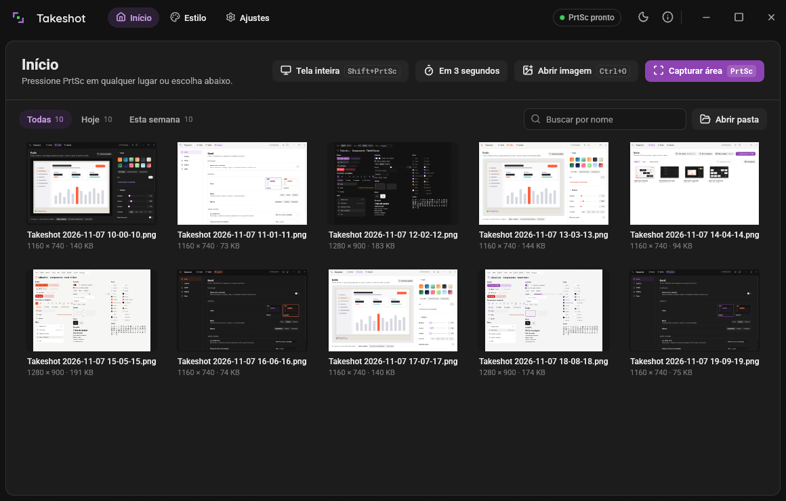
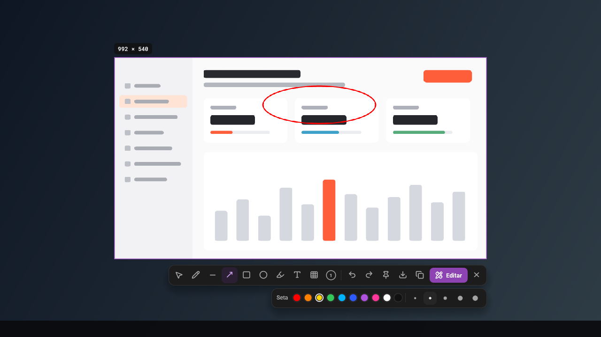
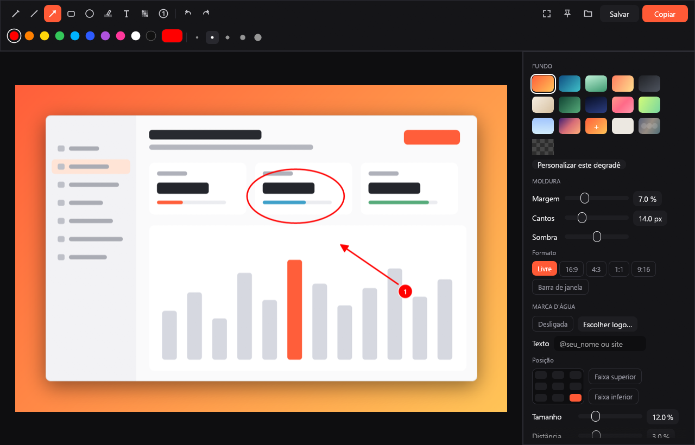

# Takeshot

Ferramenta de captura de tela para Windows, macOS e Linux: captura instantânea com anotação e um editor para fundos, cantos arredondados, sombra e marca d'água.



## O que faz

**Captura**



- Seleção de área com lupa de pixels, coordenadas e cor (tecla `C` copia o hex da cor sob o cursor).
- Alças para ajustar a seleção, setas movem, `Shift`+setas redimensionam, `Ctrl+A` pega a tela inteira. Com um objeto selecionado, as setas movem o objeto.
- Opção de lembrar a última área selecionada.
- Tela inteira direto no editor e captura com temporizador de 3 segundos.

**Ferramentas** (barra sob a área escolhida: ferramentas, desfazer, refazer, fixar, salvar, copiar, Editar e fechar; uma segunda barra traz as opções da ferramenta ou do objeto selecionado)
- Caneta, linha, seta, retângulo, círculo/elipse, marcador, texto, borrar ou pixelar, numeração de passos.
- `Shift` enquanto arrasta: linhas em ângulos de 45°, quadrados e círculos perfeitos, traço livre reto.
- `Alt` enquanto arrasta: retângulo, círculo e desfoque a partir do centro.
- Paleta de cores com cor personalizada, 5 espessuras (a roda do mouse ajusta), retângulo e círculo preenchidos.
- Texto com várias fontes do sistema (sans, negrito, serifada, elegante, mono, impacto, condensada, manuscrita) e opção de texto com fundo.
- Toda marca continua editável, na captura e no editor: o que acabou de ser desenhado fica selecionado e já pode ser arrastado para o lugar com a própria ferramenta (o cursor vira a cruz de mover sobre ele; fora dele, a ferramenta desenha, inclusive por cima de outras formas). Com Selecionar (`V`) um clique escolhe qualquer marca, `Shift`+clique soma à seleção, arrastar move e as alças redimensionam (pontas em linha e seta, oito alças em retângulo, elipse e borrar, quatro cantos em texto, traço e numeração).
- Com algo selecionado, a barra de opções mostra a cor, a espessura e o preenchimento do objeto, muda o objeto e tem duplicar e excluir.
- Duplo clique num texto, com Selecionar ou Texto, volta a editá-lo. Excluir um passo numerado não renumera os outros.
- Desfazer e refazer cobrem criar, mover, redimensionar, mudar o estilo, duplicar e excluir; um arraste inteiro é um passo só.
- Na captura, as ferramentas de desenho começam dentro da área escolhida.

**Editor**



- Barra de título com o nome do arquivo e as dimensões, desfazer e refazer, Fixar na tela, Salvar como, Salvar e Copiar; barra de ferramentas com as dez ferramentas, cores, espessuras e zoom de 10 a 400 % (`Ctrl`+roda e a pinça do touchpad aproximam no ponteiro, em proporção ao giro; espaço ou o botão do meio arrastam a imagem).
- Painel Objeto: cor, espessura, opacidade, preenchimento, fonte e fundo do texto do objeto selecionado (ou da ferramenta), Duplicar e Excluir, e a lista de objetos: clique escolhe, o olho oculta, o botão direito traz para frente ou envia para trás. Arrastar um controle deslizante é um passo só de desfazer.
- Sobre o objeto selecionado, uma barra pequena com a cor, duplicar, trazer para frente, enviar para trás e excluir.
- Painel Estilo, o mesmo de Estilo na janela principal:
  - 12 degradês prontos, degradê personalizado (duas cores e ângulo), cor sólida, fundo com a própria captura borrada ou transparente.
  - Margem, cantos arredondados, sombra, barra de janela e formatos 16:9, 4:3, 1:1 e 9:16.
  - Marca d'água com logo (PNG, JPG, WebP) e texto: 9 posições (cantos, bordas, centro) ou faixa superior/inferior com cor própria; tamanho, distância e opacidade ajustáveis; sobre o fundo ou sobre a captura.
- Copiar, salvar, salvar como e fixar na tela.
- Fechar o editor com mudanças que não foram copiadas nem salvas pergunta antes: Descartar, Cancelar, ou Copiar e fechar.

**Saída**
- Sempre PNG sem perdas na resolução original da tela. Nada de envio para nuvem nem busca de imagem.
- Copiar ou salvar direto da captura pode aplicar o estilo completo, só os cantos arredondados ou nada (em Estilo).

**Extras**
- Fixar uma captura por cima das outras janelas (arrastar move, roda do mouse dá zoom, duplo clique fecha).
- Arrastar uma imagem para a janela principal ou colar com `Ctrl+V` abre no editor.

**Janela principal**
- Início: as capturas da pasta em grade, com filtros (Todas, Hoje, Esta semana) e busca por nome. Passar o mouse num card mostra copiar, editar, mostrar na pasta e mandar para a lixeira; duplo clique abre no editor; o botão direito traz o mesmo menu.
- Estilo: prévia ao vivo do fundo, da moldura e da marca d'água que vão em cada cópia, com o que acontece ao copiar ou salvar direto da captura.
- Ajustes: inicialização, aparência, janela e bandeja, captura, pasta de salvar, atalhos (com "Alterar" para gravar teclas novas) e sobre.
- Aparência: dois temas, TakeUI e Coral UI, em claro, escuro ou seguindo o sistema, trocados na hora em Ajustes > Geral > Aparência, assim como o idioma (Automático, English, Português). A lua e o sol na barra de título alternam entre claro e escuro.

**Bandeja**
- O Takeshot fica na área de notificação: os atalhos funcionam com a janela fechada. Abrir o programa de novo só traz a janela que já está rodando.
- Menu do ícone (clique direito): capturar área, tela inteira ou em 3 segundos; abrir o Takeshot; as 5 capturas recentes (clique copia, `Shift`+clique abre no editor) e a pasta delas; estilo e marca d'água; ajustes; tema claro, escuro ou do sistema; sobre; sair.
- Clique esquerdo no ícone abre o Início ou captura uma área, como estiver em Ajustes.
- O X da janela pergunta na primeira vez se é para sair ou minimizar para a bandeja, e pode lembrar a escolha (muda em Ajustes > "Ao clicar no X"). Sair de vez é pelo menu da bandeja.
- Ajustes > "Iniciar com o sistema" abre o Takeshot no login, direto na bandeja (`takeshot --minimized`).

## Atalhos

| Tecla | Ação |
|---|---|
| `PrtSc` (Mac: `Ctrl+Shift+2`) | Capturar área |
| `Shift+PrtSc` (Mac: `Ctrl+Shift+1`) | Tela inteira |
| `P` `L` `A` `R` `O` `M` `T` `B` `N` | Caneta, linha, seta, retângulo, círculo, marcador, texto, borrar, numeração |
| `V` | Selecionar: escolher, mover e redimensionar objetos, ou mover e ajustar a área |
| `Delete` ou `Backspace` | Excluir os objetos selecionados |
| `Ctrl+D` | Duplicar os objetos selecionados (12 px para a direita e para baixo) |
| setas / `Shift`+setas | Mover os objetos selecionados 1 px / 10 px |
| `Ctrl+C` / `Ctrl+S` | Copiar / salvar |
| `Enter` ou `Ctrl+E` | Abrir no editor |
| `Ctrl+T` | Fixar na tela |
| `Ctrl+Z` / `Ctrl+Y` ou `Ctrl+Shift+Z` | Desfazer / refazer |
| `Esc` | Fechar a captura (digitando um texto, só encerra o texto); no editor, limpar a seleção de objetos |
| `Ctrl+W` | Fechar o editor (pergunta se há mudanças não exportadas) |
| `Ctrl+0` / `Ctrl+1` / `Ctrl+=` / `Ctrl+-` | Editor: ajustar à janela / 100 % / aproximar / afastar |
| espaço + arrastar | Editor: mover a imagem ampliada |

Os atalhos globais funcionam enquanto o Takeshot estiver na bandeja e podem ser trocados em Ajustes > Atalhos. Com uma captura aberta, um novo `PrtSc` não faz nada.

## Download

Baixe em [Releases](../../releases) ou nos artefatos da última execução do workflow `build`:

- **Windows**: `takeshot-windows-x64.zip`. Se o `PrtSc` abrir a Ferramenta de Captura do Windows, desligue em Configurações > Acessibilidade > Teclado > "Usar a tecla Print Screen para abrir a captura de tela", ou ligue Ajustes > Atalhos > "Usar prioridade do Takeshot" (um gancho de teclado que pega o `PrtSc` antes dos outros programas; alguns antivírus estranham). No Windows 10 o ícone novo começa escondido na seta `^` da bandeja: arraste-o para a barra.
- **macOS** (Apple Silicon e Intel): `takeshot-macos-universal.zip`. O app não é assinado pela Apple: na primeira vez, clique com o botão direito em Takeshot.app > Abrir, ou rode `xattr -cr Takeshot.app`. Libere em Ajustes do Sistema > Privacidade e Segurança > Gravação de Tela.
- **Linux**: `takeshot-linux-x64.tar.gz`. O ícone da bandeja precisa de `libayatana-appindicator3-1` (ou `libappindicator3-1`) e de um painel com AppIndicator; sem ele o app funciona sem ícone, e "Sair do Takeshot" fica em Ajustes > Geral. No Wayland um app não consegue esconder a própria janela: "Minimizar para a bandeja" e o início com o sistema minimizam a janela na barra de tarefas, e ela volta pelo clique nela. Atalhos globais precisam de X11; no Wayland a captura passa pelo portal do sistema e os atalhos são do desktop: crie um que rode `takeshot --capture` (ou `takeshot --capture --full`).

## Problemas conhecidos

- **Barra de título**: o Takeshot desenha a própria barra de título. Com alguns drivers de vídeo Intel no Windows 10 e 11, janelas sem a borda do sistema mostram uma faixa preta no topo ou recebem os cliques deslocados. Para voltar à barra do sistema, abra com `takeshot --native-titlebar` ou defina a variável de ambiente `TAKESHOT_NATIVE_TITLEBAR=1`.

## Compilar

```sh
cargo build --release
```

No Windows o `rust-toolchain.toml` usa o toolchain MSVC. Em outros sistemas rode com `RUSTUP_TOOLCHAIN=stable cargo build --release`. No Linux instale antes: `libgtk-3-dev libxcb1-dev libxcb-randr0-dev libxkbcommon-dev libwayland-dev libdbus-1-dev libpipewire-0.3-dev libclang-dev libegl1-mesa-dev libgbm-dev`.

`takeshot --screenshot saida.png` abre a janela, desenha 120 quadros e salva a imagem dela (usado na verificação automática; não passa pela bandeja nem pela instância única). `takeshot --edit` abre o editor com uma imagem de exemplo; `--page editor` e `--page captura` abrem o editor e a captura na imagem de exemplo (com `--theme`, `--mode` e `--lang` para conferir os temas). `takeshot --minimized` sobe só na bandeja.

## Licença

Copyright (c) 2026-present Takeflow Sistemas

Licenciado sob a [GNU Affero General Public License v3.0 ou posterior](LICENSE). Avisos de terceiros em [THIRD_PARTY_NOTICES.md](THIRD_PARTY_NOTICES.md).
